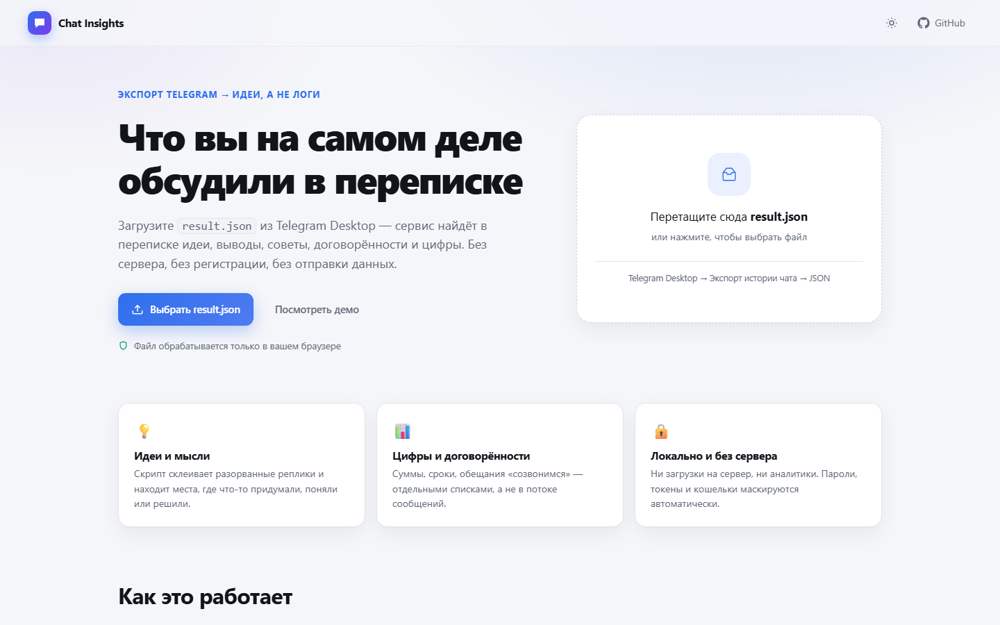
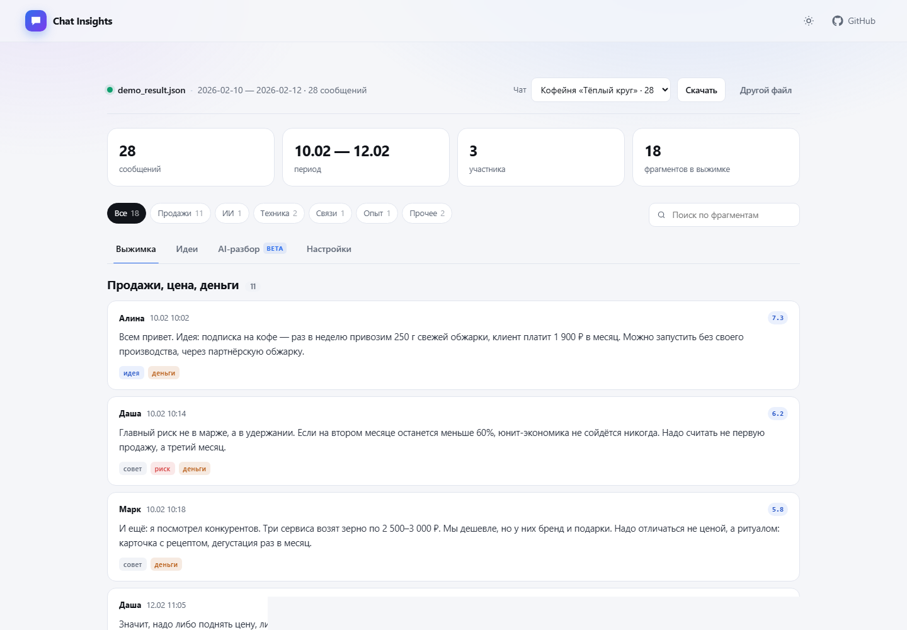
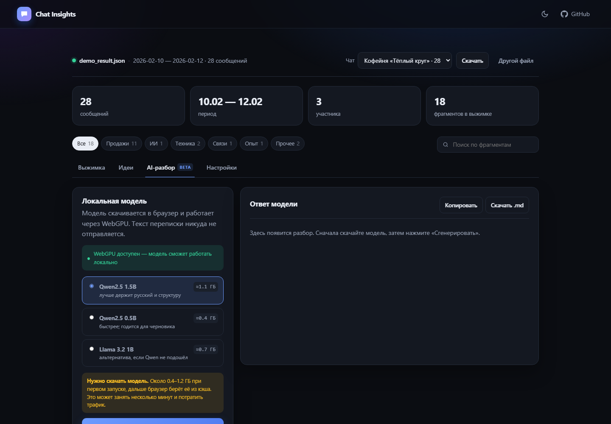

# Chat Insights

**Разбор экспорта Telegram прямо в браузере: идеи, мысли, договорённости и цифры — вместо «ага» и «ок».**

Загрузите `result.json` из Telegram Desktop и получите выжимку из переписки. Ни сервера,
ни регистрации, ни отправки файла куда-либо: всё считается локально, в вашей вкладке.



## Что умеет

- **Склеивает разорванные реплики.** В Telegram мысль часто разбита на десять сообщений —
  сервис собирает их одного автора в один смысловой фрагмент.
- **Находит информативное.** Эвристика оценивает длину, маркеры («идея», «понял», «надо»,
  «риск»), цифры, ссылки и реакции, а «ага» и «😂» отсеивает.
- **Раскладывает по темам.** Продажи, ИИ и разработка, инфраструктура, связи, рынок,
  риски, обучение, личное.
- **Показывает идеи отдельно.** Идеи и планы, выводы, советы, риски и деньги — вкладка
  «Идеи» и отдельные секции в выжимке.
- **Ищет и фильтрует.** Поиск по тексту, фильтр по темам, порог информативности.
- **Маскирует чувствительное.** Пароли, токены, кошельки, телефоны, email, номера карт
  заменяются маркерами ещё до анализа.
- **Экспортирует.** Markdown-выжимка, CSV с фрагментами, JSON с данными.
- **Работает офлайн.** После загрузки страницы сеть не нужна (кроме первого скачивания
  AI-модели, если вы её включите).
- **Тёмная и светлая тема**, адаптивная вёрстка, горячие клавиши (`Ctrl+O`).

Мультичат-экспорты поддерживаются: если в файле несколько чатов, нужный выбирается в списке.

## Демо

Нажмите «Посмотреть демо» на главной — загрузится вымышленная переписка кофейни.
Она же доступна по адресу `?demo=1`.



## Как это работает

1. **Разбор.** Поддерживаются одиночный чат, список сообщений и мультичат-экспорт
   (`chats.list`). Текст собирается из сущностей (`text_link`, `code`, `blockquote`),
   служебные сообщения отбрасываются.
2. **Склейка.** Подряд идущие сообщения одного автора с паузой меньше 180 секунд
   объединяются в фрагмент.
3. **Оценка.** Балл складывается из длины, маркеров, цифр, вопросов, технических
   терминов, реакций и ссылок; короткие реплики и смолток штрафуются.
4. **Темы и категории.** Словарь ключевых слов (работает по префиксам, поэтому
   `прода` ловит «продать», «продажи», «продавать»).
5. **Отбор.** Порог, минимальная длина, дедупликация похожих фрагментов, лимит.

Пайплайн портирован с Python-версии и проверен на реальном экспорте: совпадают
количество сообщений, фрагментов и отобранных карточек.

## Приватность

- Файл читается через `FileReader`/`Blob.text()` и остаётся в памяти вкладки.
- Нет запросов к серверу, нет аналитики и трекеров.
- Настройки хранятся в `localStorage`, файл — нигде.
- Маскировка секретов — best effort: сырой экспорт всё равно не стоит публиковать.

## AI-режим (по желанию)

Кнопка «AI-разбор» запускает небольшую модель **прямо в браузере** через
[WebGPU](https://developer.mozilla.org/docs/Web/API/WebGPU_API) и
[WebLLM](https://github.com/mlc-ai/web-llm). Текст никуда не отправляется.



| Модель | Скачивание | Видеопамять | Комментарий |
|---|---|---|---|
| Qwen2.5 1.5B | ≈1.1 ГБ | ~1.6 ГБ | лучше держит русский и структуру |
| Qwen2.5 0.5B | ≈0.4 ГБ | ~0.9 ГБ | быстрее, годится для черновика |
| Llama 3.2 1B | ≈0.7 ГБ | ~1.1 ГБ | альтернатива |

Важно:

- Нужен **Chrome или Edge 113+** на компьютере с WebGPU. На старых видеокартах и в
  Safari режим может не заработать — обычный анализ при этом доступен всегда.
- Модель **скачивается при первом запуске** (0.4–1.2 ГБ) и кэшируется браузером.
  Это трафик и несколько минут ожидания.
- Модель видит только отобранные фрагменты (до ~4500 символов), а не весь чат.
- Маленькие модели могут ошибаться в цифрах и деталях — проверяйте по исходнику.

## Локальный запуск

Нужен Node.js 20.19+ или 22.12+.

```bash
npm install
npm run dev      # http://localhost:5173
npm run build    # dist/
npm run preview  # проверить сборку
npm test         # unit-тесты
```

`dist/index.html` нельзя открывать двойным кликом через `file://` — ES-модули
загружаются только по HTTP. Для проверки сборки используйте `npm run preview`.

## Публикация на GitHub Pages

1. Создайте репозиторий и загрузите проект:

   ```bash
   git init
   git add .
   git commit -m "init: chat insights"
   git branch -M main
   git remote add origin https://github.com/<username>/tg-chat-insights.git
   git push -u origin main
   ```

2. В `index.html` замените `your-username` на свой логин (две ссылки: шапка и подвал).
3. В настройках репозитория: **Settings → Pages → Build and deployment → Source:
   GitHub Actions**.
4. Workflow `.github/workflows/deploy.yml` сам соберёт сайт и опубликует его после
   пуша в `main`.

Сайт будет доступен по адресу `https://<username>.github.io/tg-chat-insights/`.
`base: "./"` в `vite.config.ts` позволяет работать и в корне домена, и в подпапке.

## Структура проекта

```
src/
  core/          # парсинг, склейка, оценка, темы, выжимка, промпт
  ui/            # контроллер интерфейса и безопасный markdown
  ai/webllm.ts   # ленивая загрузка WebLLM
  styles.css
tests/           # vitest: парсинг, анализ, промпт, реальный экспорт
docs/screenshots/
```

AI-библиотека подключается динамически: основной бандл ~47 КБ, тяжёлый чанк WebLLM
(~6 МБ) скачивается только при нажатии «Скачать модель».

## Ограничения

- Это эвристики, а не языковая модель: ирония и идеи без ключевых слов могут не попасть
  в топ, поэтому выжимку стоит просматривать глазами.
- Голосовые, видео и фото не расшифровываются — только помечаются.
- Очень большие экспорты (сотни мегабайт) требуют памяти и времени на `JSON.parse`.
- AI-режим зависит от драйверов и браузера.

## Идеи для развития

- [ ] Стемминг/лемматизация вместо префиксов.
- [ ] Свои темы и ключевые слова в настройках.
- [ ] Опциональный OCR/транскрипция медиа.
- [ ] Сохранение разбора в IndexedDB.
- [ ] Экспорт в DOCX/PDF.
- [ ] Локализация интерфейса (EN).

## Лицензия

MIT. Демо-переписка вымышлена и не содержит реальных данных.
